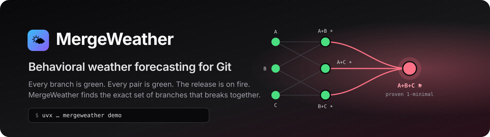
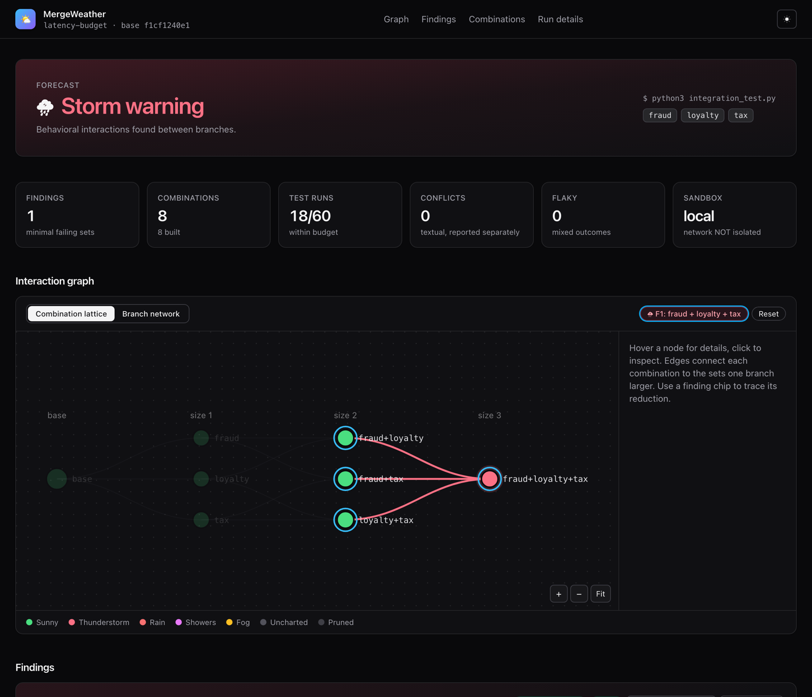
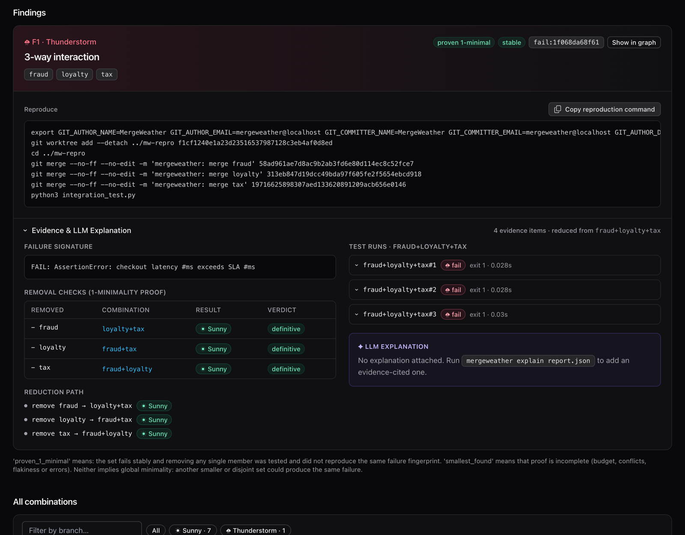

<p align="center">
  
</p>

<p align="center">
  <a href="https://github.com/AnvitDevadiga/merge-weather/actions/workflows/ci.yml"></a>
  <a href="LICENSE"></a>
  
  
  
</p>

<p align="center"><b>Every branch is green. Every pair is green. The release is on fire.</b><br>
MergeWeather finds the exact set of Git branches that breaks <i>only when they ship together</i>,<br>
and gives you the commands to reproduce it.</p>

---

## ⚡ Try it in one command

```sh
uvx --from git+https://github.com/AnvitDevadiga/merge-weather mergeweather demo
```

That's it. The demo builds a throwaway Git repo with a hidden **3-way interaction bug**,
tests every combination of branches with a live terminal dashboard, narrows the failure
down to the guilty branches, and opens an interactive HTML report in your browser.
Your files are never touched.

> No `uv`? `pipx run --spec git+https://github.com/AnvitDevadiga/merge-weather mergeweather demo`
> works too. Requires Python ≥ 3.9 and `git`.

```text
╭──────────────────────────── MergeWeather forecast ────────────────────────────╮
│                               ⛈  Storm warning                                │
╰───────────────────────────────────────────────────────────────────────────────╯
╭───────────────────┬────────────────┬──────╮
│ Combination       │ Weather        │ Runs │
├───────────────────┼────────────────┼──────┤
│ base              │ ☀ Sunny        │    3 │
│ fraud             │ ☀ Sunny        │    1 │
│ loyalty           │ ☀ Sunny        │    1 │
│ tax               │ ☀ Sunny        │    1 │
│ fraud+loyalty     │ ☀ Sunny        │    3 │
│ fraud+tax         │ ☀ Sunny        │    3 │
│ loyalty+tax       │ ☀ Sunny        │    3 │
│ fraud+loyalty+tax │ ⛈ Thunderstorm │    3 │
╰───────────────────┴────────────────┴──────╯
╭─ ⛈ F1 Thunderstorm ──────────────────────────────────────────────────╮
│ fraud + loyalty + tax                                                │
│ 3-way interaction · proven_1_minimal · stable · fail:1f068da68f61    │
│   FAIL: AssertionError: checkout latency #ms exceeds SLA #ms         │
╰──────────────────────────────────────────────────────────────────────╯
```

## 🌩 The problem: N-way integration hell

Merge conflicts are the *easy* failures, because Git tells you about them. The expensive
ones merge cleanly, pass CI on every branch, and only break when a particular **set** of
changes lands together:

- three features each add "just 60 ms" to a request path with a 250 ms budget
- two config defaults that are each safe, but not together
- a retry policy, a timeout change and a new middleware that make a cascade only in combination

CI tests each branch against `main`. Your release tests them **all at once**. The gap
between those two is where MergeWeather works:

```text
                 tested by MergeWeather, in canonical order, inside a sandbox
  size 0        size 1              size 2                       size 3
  ──────        ──────              ──────                       ──────
                fraud    ☀ ───┬──── fraud+loyalty  ☀ ───╮
  base  ☀ ──┼── loyalty  ☀ ───┼──── fraud+tax      ☀ ───┼──── fraud+loyalty+tax  ⛈
                tax      ☀ ───┴──── loyalty+tax    ☀ ───╯            │
                                                                     ▼
              every single branch passes · every pair passes · the triple fails
                                                                     │
           reduce: drop one branch at a time, keep the failure fingerprint
                                                                     │
           fraud ✗ → loyalty+tax ☀    loyalty ✗ → fraud+tax ☀    tax ✗ → fraud+loyalty ☀
                                                                     │
                     ⛈ F1: {fraud, loyalty, tax} — proven 1-minimal, stable
```

A pairwise matrix would never find this one: it takes all three branches together to
break the test.

## ☁️ The Weather Scale

| Forecast | Meaning |
|---|---|
| ☀ **Sunny** | The combination passes. |
| ⛈ **Thunderstorm** | Branches pass alone but **fail together**. This is a behavioral interaction, the thing you came for. |
| 🌧 **Rain** | A single branch fails on its own (not an interaction, just a broken branch). |
| 🌦 **Showers** | Flaky: the *same tree* gave mixed results across repeats. |
| 🌫 **Fog** | Textual merge conflict. It's reported separately and never counted as a behavioral failure. |
| 🌪 **Tornado** | Infrastructure error: the sandbox couldn't run the command. |
| ❔ **Uncharted** | Not run because the budget ran out. Listed so you know exactly what wasn't covered. |

The overall verdict is one of **⛈ Storm warning**, **☀ Clear skies**, **🌥 Partly cloudy**
(budget ran out) or **🌪 Base is broken**.

## 📊 The interactive report

Every run writes `report.json`, `report.md` and a single self-contained **`report.html`**
(about 110 KB, no network requests, works offline and as a CI artifact).

<p align="center"></p>

- **Combination lattice:** every tested set, with a column per size. Click a finding to
  light up how it was reduced and the checks that prove it's minimal. Hover for
  details, click to inspect, scroll to zoom, drag to pan.
- **Branch network:** interactions shown as hubs, conflicts as dashed edges.
- **Evidence & LLM Explanation drawer** for every finding: the failure signature, the
  removal-check table, the reduction path, raw test output, and (optionally) an
  explanation where every claim cites evidence.
- **Copy reproduction command:** one click gives you the exact `git merge` sequence and
  test command.
- Filterable table of every combination, and a light/dark toggle (dark by default).

<p align="center"></p>

## 🚀 Use it on your repo

```sh
pipx install git+https://github.com/AnvitDevadiga/merge-weather   # or: uv tool install git+…

mergeweather run \
  --repo . \
  --base main \
  -b fraud=feature/fraud-check \
  -b tax=feature/tax-service \
  -b loyalty=feature/loyalty \
  --test-cmd "python -m pytest tests/integration -q" \
  --image python:3.12-slim
```

`--base` must be the true common base (every branch must descend from it). Branches take
an optional `label=` prefix. Each run tests one image and one command; put setup in the
command (`pip install -e . && pytest ...`) or bake it into the image. The container has
no network.

<details>
<summary><b>All options</b></summary>

| Option | Default | Meaning |
|---|---|---|
| `--max-runs` | 60 | Budget: total test executions |
| `--max-seconds` | — | Budget: wall-clock limit |
| `--max-size` | 4 | Largest combination size to explore |
| `--repeats` | 3 | Repetitions for any non-passing result (flakiness detection) |
| `--full-first` | off | Test the full branch set right after the base, then reduce |
| `--fingerprint-regex` | built-in | Which output lines identify "the same failure" |
| `--sandbox` | `docker` | `docker`, `local` (needs `--allow-unsandboxed`) or `auto` |
| `--image` | `python:3.12-slim` | Container image |
| `--timeout` / `--memory` / `--cpus` | 120 s / 1024 MB / 1 | Per-run limits |
| `--pass-env` | none | Environment variable to pass through (repeatable) |
| `--out` / `--formats` | `mergeweather-report` / `json,md,html` | Output |
| `--plain` / `-q` | | Log lines instead of the dashboard / verdict only |

| Exit code | Meaning |
|---|---|
| 0 | no failing combinations (explored space fully covered) |
| 1 | interactions found |
| 2 | usage error, invalid ref, base not an ancestor, sandbox unavailable |
| 3 | the base itself fails |
| 4 | inconclusive: the budget ran out |
| 130 | interrupted (workspaces and processes cleaned up) |

Other commands: `mergeweather demo [--harmless]`, `mergeweather explain report.json`,
`mergeweather render report.json`, `mergeweather clean`.
</details>

## 🔬 How it works

1. **Pin.** The base and every branch are resolved to full commit IDs before anything runs.
2. **Copy, don't touch.** Commits are fetched into a disposable repository under a temp
   directory. Your refs, index, working tree and stash are never modified. Each
   combination's tree is exported with `git archive` into a plain directory with no
   `.git` and no credentials.
3. **Canonical merges.** A combination is a *set*. It is always built from the base by
   running `git merge --no-ff` on each member in ascending label order, with a fixed
   identity and timestamp, so the same set gives the same merge commits and tree IDs
   every time. Both are recorded.
4. **Explore within budget.** The order is base (must pass stably), then singles, pairs,
   and larger sets. Supersets of sets that already failed, were flaky or conflicted are
   pruned. Identical trees share their evidence.
5. **Fingerprint.** A failure's identity is its outcome plus normalized signature lines,
   with numbers, addresses and temp paths stripped. Timeouts get their own fingerprint.
6. **Repeat.** Every non-passing result is rerun. Mixed outcomes become 🌦 Showers, and
   findings built on them are labeled `unstable`.
7. **Reduce.** Branches are dropped one at a time while the *same fingerprint* still
   reproduces.

### Honest minimality

- **`proven_1_minimal`**: the set fails stably, and removing *any single* member was
  tested (with repeats) and definitively did not reproduce the fingerprint.
- **`smallest_found`**: the proof is incomplete, and the report says why (budget,
  conflicts, flakiness, errors).

MergeWeather **never claims global minimality**. A different, disjoint set could
produce the same failure.

## 🔒 Sandbox

The default `docker` backend runs each test with `--network none`, memory and swap caps,
a CPU cap, `--pids-limit`, `--cap-drop ALL`, `no-new-privileges`, a non-root user, a
tmpfs `/tmp` and a wall-clock timeout. No host environment variables are passed unless
you name them with `--pass-env`.

The `local` backend is meant for trusted code only, and you have to opt in with
`--allow-unsandboxed`. It enforces the timeout, scrubs credentials from the environment,
uses a throwaway `HOME` and applies rlimits where the OS supports them, but it **cannot
block network access**. Every report states which guarantees actually held. `demo`
uses Docker when it's available and otherwise falls back to the local backend, because
the fixture is bundled, trusted code.

## 🧠 Optional: evidence-cited explanations

```sh
export ANTHROPIC_API_KEY=...
mergeweather explain mergeweather-report/report.json            # adds an explanation to the report
mergeweather explain mergeweather-report/report.json --dry-run  # print the exact prompt, no API call
```

The model only sees evidence already in the report. Every claim must cite evidence IDs
(`diff:tax`, `combo:fraud+loyalty+tax`). Citations to unknown IDs are dropped, and
uncited or inferred claims are labeled **HYPOTHESIS**. Findings are never changed by
this step.

## 🛠 Development

```sh
git clone https://github.com/AnvitDevadiga/merge-weather && cd merge-weather
make install   # uv venv + editable install with dev extras
make test      # 40 tests: SIGINT/SIGTERM cleanup, flaky runs, invalid refs,
               # merge conflicts, budget exhaustion, report rendering, demo
make demo
```

See **[CONTRIBUTING.md](CONTRIBUTING.md)** for the dev workflow and how to send a PR.

## 📄 License

[MIT](LICENSE) © Anvit Devadiga
